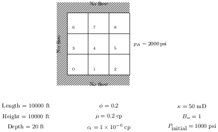

# Homework Assignment 16

[](https://github.com/PGE323M/assignment16/actions/workflows/main.yml)

## Instructions

Work through the [Simple 2D Problem in CMG tutorial](https://youtu.be/Tx1l-dQO5TA).
This is the CMG counterpart to the two-dimensional reservoir problem in
[Assignment 15](https://github.com/PGE323M/assignment15).



Save your CMG input as `assignment16.dat`. When editing the input file to change
the grid from 1D to 2D and adjust permeability as shown in the tutorial, also change

```text
DTOP
5*1000
```

to

```text
DTOP
12*1000
```

because the CMG model now contains 12 gridblocks, including the boundary blocks.
Run the simulation for three days with one-day output intervals.

Open the simulation results in CMG Results and export the pressure history for
**gridblock {3, 3, 1}** in **psi**, including the initial state and days 1, 2, and 3.
Use the CMG CSV export format: two introductory rows, then the column-heading row
and four data rows. Export only the requested pressure series so that pressure
is the last column. Save the file as **`assignment16.csv`** in this repository.
Do not replace the export with manually entered pressures.

The 2026 CMG interface differs slightly from the video: the Reservoir, Components,
and Wells menus are on the menu bar at the top of the Builder window.

## Testing

Run the supplied output check from the repository directory:

```bash
python test.py
```

`OK` means the exported pressures pass the check. If the check fails, verify the
model inputs, selected gridblock, pressure units, and export settings.
The checker expects four pressures and uses the original 5 psi absolute tolerance.
Python 3.11 is sufficient; no additional Python packages are required.

## Submission

Submit only the CMG-exported `assignment16.csv`. Keep your CMG input and other
simulation files locally. Do not modify the supplied checker or workflows.

```bash
git add assignment16.csv
git commit -m "Submit Assignment 16"
git push origin master
```

Check the repository's Actions page to confirm that the output check passes for
your submitted commit.
